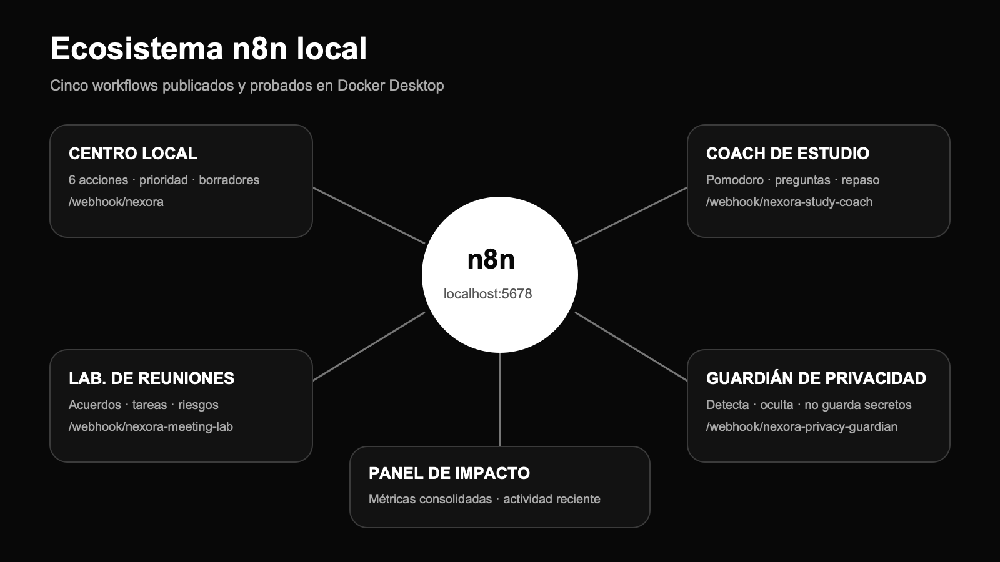
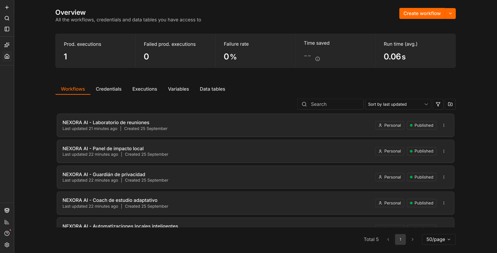

# NEXORA AI


NEXORA AI es una suite académica multimodal que integra conversación, herramientas de texto, visión, generación de imágenes, voz sintética, transcripción, moderación y automatización mediante n8n. Incluye una versión local en Streamlit y una experiencia serverless publicada en Vercel, sin incrustar credenciales en el código.

## Estado del proyecto

**Aplicación publicada:** [nexora-ai-blue-three.vercel.app](https://nexora-ai-blue-three.vercel.app/)

| Componente | Estado | Descripción |
|---|---|---|
| Chat con IA | Implementado | Utiliza la Responses API y conserva el contexto de la sesión |
| Voz a voz | Implementado | Conversación natural mediante Realtime API y WebRTC |
| Studio IA | Implementado | Once herramientas para redactar, estudiar, programar, traducir, extraer y analizar |
| Visión | Implementado | Analiza PNG, JPG y WEBP con una pregunta personalizada |
| Generación de imágenes | Implementado | Crea imágenes descargables en tres formatos |
| Texto a voz | Implementado | Narra resultados en MP3 con aviso de voz IA |
| Moderación | Implementado | Clasifica contenido y muestra categorías detectadas |
| Transcripción | Implementado | Acepta grabación directa y archivos compatibles; 25 MB en Streamlit y 4 MB en Vercel |
| Resumen de audio | Implementado | Convierte la transcripción en ideas, decisiones y pendientes |
| Exportación | Implementado | Permite descargar la transcripción en formato TXT |
| Ecosistema n8n local | Implementado | Cinco workflows publicados: centro local, estudio, reuniones, privacidad y métricas |
| Acciones externas reales | Requiere credenciales | Los borradores exigen revisión antes de conectar correo, WhatsApp o calendario |
| Pruebas de humo | Implementado | Verifican archivos esenciales y validez del workflow |

## Funcionalidades

### Studio IA multimodal

- Resume, reescribe, corrige y traduce contenido.
- Crea guías de estudio, exámenes con respuestas y guiones de exposición.
- Genera ideas, emails profesionales y análisis de argumentos.
- Explica o revisa código y extrae datos estructurados.
- Convierte el resultado en voz IA, lo descarga o lo continúa en el chat.
- Analiza imágenes y texto visible con una instrucción personalizada.
- Genera imágenes cuadradas, horizontales o verticales.
- Revisa texto con el modelo de moderación y presenta categorías para revisión humana.

### Conversación de voz en tiempo real

- Mantiene una conversación directa de voz a voz con `gpt-realtime-2.1`.
- Utiliza WebRTC para transportar el micrófono y el audio generado con baja latencia.
- Detecta automáticamente cuándo comienza y termina cada turno.
- Permite interrumpir, silenciar y finalizar la llamada.
- Muestra una transcripción en vivo cuando el servicio entrega eventos de texto.
- La clave estándar solo se utiliza en el endpoint del servidor; nunca se incrusta en JavaScript.

La experiencia publicada conserva también el chat contextual, la grabación o carga de audio, la edición de la transcripción, el resumen, la descarga TXT, la reutilización en chat y el formulario para n8n. La voz es una función adicional y no reemplaza las capacidades anteriores.

### Chat inteligente

- Envía preguntas a un modelo disponible en la cuenta de OpenAI.
- Mantiene los últimos mensajes como contexto durante la sesión.
- Incluye instrucciones orientadas a productividad y apoyo académico.
- Permite cambiar el modelo sin editar el código.
- Puede reiniciar la conversación desde la interfaz.

### Transcripción de audio

- Graba audio directamente desde el navegador.
- Acepta MP3, MP4, MPEG, MPGA, M4A, WAV y WEBM.
- Valida el límite de 25 MB antes de hacer la solicitud.
- Utiliza `gpt-transcribe` para transformar voz en texto.
- Genera un resumen con idea central, puntos clave, decisiones y pendientes.
- Permite descargar el texto o reutilizarlo dentro del chat.

### Automatizaciones con n8n

- Ejecuta cinco workflows independientes mediante webhooks locales.
- Ofrece seis acciones: `sheet`, `email`, `whatsapp`, `task`, `study` y `calendar`.
- Detecta prioridad alta, media o normal según el contenido.
- Guarda cada solicitud en `n8n-local/nexora-events.jsonl` dentro de la Mac.
- Entrega emails reales por SMTP a un buzón Mailpit visible en `http://localhost:8025`, sin salir de la Mac.
- Crea una hoja CSV, un outbox local de WhatsApp, checklists Markdown, sesiones de estudio y calendarios ICS dentro de `n8n-local/outputs/`.
- Valida y normaliza el contenido antes de procesarlo.
- No requiere cuentas, credenciales ni suscripciones para la demostración local.
- Incluye un coach que crea bloques de estudio, preguntas y repaso espaciado.
- Convierte transcripciones de reuniones en actas con acuerdos, tareas y riesgos.
- Detecta y oculta correos, teléfonos, documentos, números financieros y claves API sin guardar el contenido sensible.
- Consolida toda la actividad en un panel de impacto local.

| Workflow | Webhook | Resultado destacado |
|---|---|---|
| Centro local | `POST /webhook/nexora` | Seis acciones, correo SMTP local y artefactos verificables |
| Coach de estudio adaptativo | `POST /webhook/nexora-study-coach` | Sesión por bloques, conceptos, preguntas y repaso espaciado |
| Laboratorio de reuniones | `POST /webhook/nexora-meeting-lab` | Resumen, decisiones, responsables, tareas y riesgos |
| Guardián de privacidad | `POST /webhook/nexora-privacy-guardian` | Puntaje de riesgo y versión redactada sin persistir secretos |
| Panel de impacto local | `GET /webhook/nexora-impact-dashboard` | Totales, alertas, aprobaciones y actividad reciente |



### Evidencia visual de n8n

La documentación incluye capturas reales tomadas desde Safari sobre la instancia local. Se muestran los cinco workflows publicados, el recorrido de cada flujo y la configuración del Webhook de entrada.



| Evidencia | Archivo |
|---|---|
| Centro de automatizaciones | [`nexora-workflow-centro-local.png`](docs/screenshots/nexora-workflow-centro-local.png) |
| Coach de estudio | [`nexora-workflow-coach-estudio.png`](docs/screenshots/nexora-workflow-coach-estudio.png) |
| Laboratorio de reuniones | [`nexora-workflow-reuniones.png`](docs/screenshots/nexora-workflow-reuniones.png) |
| Guardián de privacidad | [`nexora-workflow-privacidad.png`](docs/screenshots/nexora-workflow-privacidad.png) |
| Panel de impacto | [`nexora-workflow-panel-impacto.png`](docs/screenshots/nexora-workflow-panel-impacto.png) |
| Parámetros del Webhook | [`nexora-configuracion-webhook.png`](docs/screenshots/nexora-configuracion-webhook.png) |

El capítulo **Integración con n8n** de [`DOCUMENTACION_COMPLETA.md`](docs/DOCUMENTACION_COMPLETA.md) explica la configuración y función de cada nodo. La versión Word incorpora las mismas capturas con pies de figura y tablas explicativas.

### Experiencia visual

- Identidad propia con icono de NEXORA AI.
- Fondo negro, tipografía blanca y escala de grises.
- Animaciones discretas que comunican escucha y respuesta.
- Navegación adaptable para escritorio y móvil.
- Controles de alto contraste sin colores decorativos intensos.

## Arquitectura

```text
┌──────────┐      ┌──────────────────────────────┐
│ Usuario  ├─────►│ Streamlit local o web Vercel │
└──────────┘      └───────────┬──────────────────┘
                              │
                   ┌──────────┴──────────┐
                   │                     │
        ┌──────────▼──────────┐  ┌──────▼─────────┐
        │ OpenAI Platform     │  │      n8n       │
        │ Responses           │  │ validación     │
        │ Transcriptions      │  │ prioridad      │
        │ Vision + Images     │  └──────┬─────────┘
        │ Speech + Moderation │         │
        │ Realtime + WebRTC   │         │
        └─────────────────────┘         │
                         Bitácora tareas estudio borradores
```

Streamlit actúa como capa de servidor y utiliza la clave únicamente en memoria o desde una variable de entorno. n8n recibe solo el contenido necesario para la automatización; nunca recibe la clave de OpenAI.

## Tecnologías

| Tecnología | Uso en el proyecto |
|---|---|
| Python 3 | Lógica principal de la aplicación |
| Streamlit | Interfaz local y manejo de sesión |
| HTML, CSS y JavaScript | Interfaz minimalista desplegada |
| Vercel | Hosting HTTPS y funciones serverless |
| WebRTC y Realtime API | Conversación de voz a voz |
| OpenAI Python SDK | Chat y transcripción |
| Responses API | Generación de respuestas del asistente |
| Image API | Generación de imágenes desde texto |
| Speech API | Narración de texto en MP3 |
| Moderations API | Clasificación de seguridad |
| Entrada multimodal | Análisis de imágenes mediante Responses API |
| Transcriptions API | Conversión de audio en texto |
| n8n | Orquestación de automatizaciones |
| Docker Compose | Ejecución local opcional de n8n |
| Requests | Envío de payloads al webhook |
| Pytest | Pruebas de humo |

## Estructura del repositorio

```text
NexoraAI/
├── app.py                              # Aplicación Streamlit
├── public/                             # Interfaz web minimalista para Vercel
├── api/                                # Texto, visión, imagen, voz, moderación, Realtime y n8n
├── package.json                        # Validación de JavaScript
├── vercel.json                         # Configuración de despliegue
├── assets/nexora-logo.svg              # Logo vectorial principal
├── assets/nexora-icon.png              # Versión PNG para Streamlit y Word
├── automations/                        # Cinco workflows importables de n8n
├── n8n-local/.gitkeep                   # Carpeta local para la bitácora ignorada por Git
├── docs/
│   ├── DOCUMENTACION_COMPLETA.md       # Fuente del informe académico
│   ├── images/                         # Cuatro láminas técnicas en SVG y PNG
│   └── Documentacion_NEXORA_AI.docx    # Documento Word final
├── tests/test_smoke.py                 # Pruebas básicas
├── scripts/build_documentation.py      # Generador del Word académico
├── .streamlit/config.toml              # Tema y límite de carga
├── .env.example                        # Variables de entorno de ejemplo
├── docker-compose.yml                  # Servicio local de n8n
├── requirements.txt                    # Dependencias Python
├── run.sh                              # Inicio rápido macOS/Linux
└── run.bat                             # Inicio rápido Windows
```

## Requisitos

- Python 3.10 o superior.
- Una OpenAI API Key con saldo y acceso a los modelos utilizados.
- Navegador actualizado.
- Docker Desktop únicamente para ejecutar n8n localmente.

## Instalación rápida

### macOS o Linux

```bash
chmod +x run.sh
./run.sh
```

### Windows

Ejecutar `run.bat` desde el Explorador de archivos o desde CMD.

### Instalación manual

```bash
python -m venv .venv
source .venv/bin/activate
python -m pip install -r requirements.txt
streamlit run app.py
```

En Windows, la activación se realiza con `.venv\Scripts\activate`. La interfaz estará disponible normalmente en `http://localhost:8501`.

## Configuración de OpenAI

La forma más sencilla para una exposición es pegar la clave en **OpenAI API Key**. El campo oculta su contenido y la clave no se escribe en disco.

También puede utilizarse un archivo `.env`:

```bash
cp .env.example .env
```

```dotenv
OPENAI_API_KEY=sk-proj-reemplazar
OPENAI_MODEL=gpt-5-mini
N8N_WEBHOOK_URL=http://localhost:5678/webhook/nexora
```

El archivo `.env` está excluido de Git. Nunca se debe publicar una clave real en el repositorio, una captura o el informe.

En la versión Vercel se puede configurar `OPENAI_API_KEY` como variable cifrada del proyecto. Para una demostración rápida también es posible pegar la clave temporalmente en **Configuración**; se conserva solamente en la memoria de la pestaña y se envía al endpoint propio mediante HTTPS.

## Despliegue en Vercel

El directorio raíz ya incluye una aplicación estática y funciones serverless compatibles con Vercel.

1. Importar el repositorio `itslevanx/NexoraAI` desde el panel de Vercel.
2. Mantener **Framework Preset** en `Other` y el directorio raíz sin cambios.
3. Añadir `OPENAI_API_KEY` y, opcionalmente, `N8N_WEBHOOK_URL` en **Settings → Environment Variables** para producción, vista previa y desarrollo.
4. Ejecutar el despliegue.
5. Autorizar el micrófono en el navegador y probar **Voz**.

La interfaz desplegada incluye voz a voz, chat contextual, Studio IA, visión, generación de imágenes, voz sintética, moderación, grabación, carga y edición de transcripciones, resumen, descarga TXT, reutilización en chat y automatizaciones n8n. Por el límite del cuerpo de las funciones serverless, los audios e imágenes web aceptan archivos menores de 4 MB; la versión Streamlit conserva su límite de audio de 25 MB.

La arquitectura de voz sigue la recomendación oficial: el navegador usa WebRTC y un endpoint confiable crea la sesión con la clave del servidor. Para evitar que Vercel interprete de forma incompleta el cuerpo `application/sdp`, el navegador encapsula en JSON la oferta original devuelta por `createOffer()` y el endpoint la reconstruye sin alterar sus finales de línea `CRLF`, valida el encabezado `v=0` y limita su tamaño a 128 KB antes de formar la solicitud multipart hacia OpenAI. En Safari se envía `offer.sdp` directamente, como indica el ejemplo oficial, para no depender de una `localDescription` transitoria mientras se reúnen candidatos ICE. Esto evita tanto **“La oferta WebRTC no es válida”** como una oferta truncada con error `EOF`. Consulta la [guía WebRTC de OpenAI](https://developers.openai.com/api/docs/guides/voice-webrtc).

### Prueba funcional en producción

El 25 de septiembre de 2026 se verificó en Safari la instancia `https://nexora-ai-blue-three.vercel.app/`. Pasaron Chat, Studio de texto, narración, Visión, generación de imágenes, moderación, transcripción y resumen de audio, además de la conversación de voz WebRTC. La sesión de voz mostró **“Conversación activa”** y finalizó correctamente; ya no se reproduce el error **“La oferta WebRTC no es válida”**. Automatizar no se ejecutó en esta ronda, por alcance de la prueba.

## Endpoints de la versión web

| Endpoint | Propósito | Validación principal |
|---|---|---|
| `/api/chat` | Chat contextual | Al menos un mensaje |
| `/api/studio` | Once herramientas de texto | Modo permitido y 30 000 caracteres |
| `/api/vision` | Análisis de imágenes | PNG, JPG o WEBP menor de 4 MB |
| `/api/image` | Generación de imágenes | Prompt y tamaño permitido |
| `/api/speech` | Texto a voz MP3 | Máximo 2500 caracteres |
| `/api/moderate` | Clasificación de seguridad | Texto no vacío |
| `/api/transcribe` | Audio a texto | Audio menor de 4 MB |
| `/api/realtime-session` | Voz a voz por WebRTC | Oferta SDP válida |
| `/api/automation` | Envío controlado a n8n | Acción y webhook HTTPS en producción |

## Uso de Studio IA

1. Abrir **Studio IA** y elegir Texto, Visión, Imágenes o Seguridad.
2. En Texto, seleccionar una herramienta, añadir tono, idioma o nivel y pegar el contenido.
3. Descargar el resultado, continuarlo en Chat o reproducirlo con voz IA.
4. En Visión, cargar una imagen de prueba sin información sensible y formular una pregunta.
5. En Imágenes, describir la pieza, elegir formato y descargar el JPEG.
6. En Seguridad, interpretar el resultado como señal para revisión humana, no como una decisión absoluta.

## Configuración de n8n

### Levantar n8n con Docker en la Mac

```bash
./scripts/start_n8n_local.sh
```

El comando construye y levanta tres servicios: n8n en `http://localhost:5678`, el puente SMTP interno y Mailpit en `http://localhost:8025`. También importa y publica los cinco workflows. n8n conserva su configuración en el volumen `n8n_data`; las bitácoras y los artefactos de demostración quedan dentro de `n8n-local/` y están excluidos de Git.

La configuración de Docker habilita únicamente los módulos `fs` y `path` para los nodos Code, monta `./n8n-local` como `/files` y restringe el acceso de archivos a esa ruta. El servicio `mailer` recibe la orden de n8n, valida el destinatario y entrega el mensaje por SMTP a Mailpit. Ningún correo abandona la Mac.

Para la demostración rápida:

```bash
./scripts/demo_n8n_local.sh
```

Después abre `http://localhost:8025`: aparecerá el mensaje recibido con remitente, destinatario, asunto y contenido.

Para importar y publicar manualmente desde la terminal:

```bash
docker compose cp automations/nexora-n8n.json n8n:/tmp/nexora-n8n.json
docker compose cp automations/nexora-coach-estudio.json n8n:/tmp/nexora-coach-estudio.json
docker compose cp automations/nexora-laboratorio-reuniones.json n8n:/tmp/nexora-laboratorio-reuniones.json
docker compose cp automations/nexora-guardian-privacidad.json n8n:/tmp/nexora-guardian-privacidad.json
docker compose cp automations/nexora-panel-impacto.json n8n:/tmp/nexora-panel-impacto.json
docker compose exec -T n8n n8n import:workflow --input=/tmp/nexora-n8n.json
docker compose exec -T n8n n8n import:workflow --input=/tmp/nexora-coach-estudio.json
docker compose exec -T n8n n8n import:workflow --input=/tmp/nexora-laboratorio-reuniones.json
docker compose exec -T n8n n8n import:workflow --input=/tmp/nexora-guardian-privacidad.json
docker compose exec -T n8n n8n import:workflow --input=/tmp/nexora-panel-impacto.json
docker compose exec -T n8n n8n publish:workflow --id=nexoraLocalV2
docker compose exec -T n8n n8n publish:workflow --id=nexoraStudyCoachV1
docker compose exec -T n8n n8n publish:workflow --id=nexoraMeetingLabV1
docker compose exec -T n8n n8n publish:workflow --id=nexoraPrivacyGuardianV1
docker compose exec -T n8n n8n publish:workflow --id=nexoraImpactDashboardV1
docker compose restart n8n
```

Comprobación rápida:

```bash
curl http://localhost:5678/healthz
curl -X POST http://localhost:5678/webhook/nexora \
  -H 'Content-Type: application/json' \
  -d '{"action":"email","recipient":"docente@ejemplo.com","subject":"NEXORA AI - Demo","content":"Correo enviado por el workflow local."}'
```

### Activar los workflows

1. Abrir los cinco workflows cuyo nombre comienza con **NEXORA AI**.
2. Verificar las rutas de la tabla anterior.
3. Activar o publicar cada workflow.
4. Copiar `http://localhost:5678/webhook/nexora` en la barra lateral.
5. Ejecutar una acción desde **Automatizaciones**.
6. Para email, abrir `http://localhost:8025` y mostrar el mensaje recibido.

### Conectar servicios externos opcionales

El workflow local ya funciona sin cuentas de pago: valida, prioriza, registra la ejecución y produce un resultado comprobable. El correo se entrega dentro de Mailpit; CSV, WhatsApp, tareas, estudio y calendario se guardan en `n8n-local/outputs/`.

- Conectar Google Sheets con la operación Append Row si el equipo desea sincronización.
- Sustituir el puente SMTP local por Gmail, Outlook o un SMTP real únicamente cuando el equipo disponga de credenciales y destinatarios autorizados.
- Conectar WhatsApp Business Cloud o Twilio únicamente con consentimiento.
- Conectar Google Calendar u Outlook Calendar para crear eventos aprobados.
- Configurar las credenciales únicamente dentro de n8n.
- Mantener los nodos de validación y enrutamiento.
- Probar primero con cuentas y datos del equipo.

## Formato del webhook

```json
{
  "action": "email",
  "recipient": "docente@ejemplo.com",
  "subject": "Resumen de la sesión",
  "content": "Contenido revisado por el usuario",
  "source": "NEXORA AI",
  "timestamp": "2026-09-23T20:30:00"
}
```

Respuesta local de ejemplo:

```json
{
  "ok": true,
  "app": "NEXORA AI",
  "action": "task",
  "priority": "alta",
  "storedLocally": true,
  "message": "Plan de tareas preparado correctamente en n8n local"
}
```

## Pruebas

```bash
python -m pytest -q
python -m py_compile app.py
npm run check
```

Las pruebas verifican archivos esenciales, lectura del JSON, identidad del workflow, cantidad mínima de nodos y sintaxis de Python. Las llamadas reales a OpenAI no forman parte de las pruebas automáticas porque requieren una clave, saldo y acceso a red.

## Seguridad y privacidad

- La clave ingresada permanece en la sesión de Streamlit.
- En la versión web, una clave temporal vive solo en la memoria de la pestaña y viaja a los endpoints propios mediante HTTPS.
- `.env` y `.streamlit/secrets.toml` están ignorados por Git.
- El webhook recibe datos de la tarea, no la clave de OpenAI.
- La app aplica timeout y reintentos limitados.
- Los audios, imágenes, texto y prompts se envían a OpenAI; no se deben usar datos sensibles en la demo.
- La narración se identifica como voz generada por IA.
- Los endpoints validan modos, tipos MIME, tamaños y longitud antes del envío.
- Las acciones reales deben configurarse con credenciales protegidas y aprobación cuando corresponda.

## Demostración recomendada

1. Presentar el problema: chat, notas de voz y tareas manuales están dispersos.
2. Pegar la API key sin mostrarla al público.
3. Preguntar: “Explícame la computación cuántica con una analogía y crea tres preguntas de repaso”.
4. Convertir la respuesta en guía de estudio y reproducirla con voz IA.
5. Analizar una imagen académica o generar un afiche de ejemplo.
6. Grabar una nota de voz de 10 a 15 segundos, transcribirla y resumirla.
7. Enviar el contenido al webhook n8n y mostrar la ejecución visual.
8. Explicar moderación, límites y que las credenciales permanecen fuera del código.

## Limitaciones

- El historial vive únicamente durante la sesión.
- El workflow local produce registros, planes y borradores; no envía comunicaciones sin una integración y aprobación explícitas.
- No existe autenticación de usuarios.
- Los archivos están limitados a 25 MB en Streamlit y a menos de 4 MB en Vercel.
- La narración admite hasta 2500 caracteres por solicitud.
- La generación de imágenes puede requerir verificación de la organización y genera costos.
- El análisis visual y la moderación son ayudas; requieren revisión humana.
- El modelo debe estar disponible en la cuenta del usuario.
- El consumo de API puede generar costos.

## Mejoras propuestas

- Autenticación y perfiles de usuario.
- Persistencia en PostgreSQL o Supabase.
- Biblioteca de transcripciones y búsquedas.
- Respuestas en streaming.
- Panel de costos y consumo.
- Procesamiento de documentos PDF.
- Aprobación de automatizaciones reales.
- Monitoreo del despliegue y rotación programada de secretos.

## Documentación académica

- `docs/DOCUMENTACION_COMPLETA.md`: fuente editable del informe.
- `docs/Documentacion_NEXORA_AI.docx`: documento listo para Microsoft Word.

Incluye problema, objetivos, alcance, requisitos, casos de uso, arquitectura, código, instalación, manual de usuario, n8n, seguridad, pruebas, riesgos, conclusiones, glosario, bibliografía y anexos.

## Fuentes oficiales

- [Inicio rápido de OpenAI](https://developers.openai.com/api/docs/quickstart)
- [Guía de transcripción de OpenAI](https://developers.openai.com/api/docs/guides/speech-to-text)
- [Guía de visión de OpenAI](https://developers.openai.com/api/docs/guides/images-vision)
- [Guía de generación de imágenes de OpenAI](https://developers.openai.com/api/docs/guides/image-generation)
- [Guía de texto a voz de OpenAI](https://developers.openai.com/api/docs/guides/text-to-speech)
- [Guía de moderación de OpenAI](https://developers.openai.com/api/docs/guides/moderation)
- [Documentación de Streamlit](https://docs.streamlit.io/)
- [Documentación de n8n](https://docs.n8n.io/)
- [Documentación de Docker Compose](https://docs.docker.com/compose/)

## Datos del equipo

Completar antes de la entrega:

- Institución:
- Curso:
- Docente:
- Integrantes:
- Ciclo o sección:
- Fecha:

## Uso académico

Proyecto preparado con fines académicos. Antes de utilizarlo con datos reales, el equipo debe definir una licencia, revisar las políticas de los servicios conectados y mantener la aprobación humana para acciones externas.
