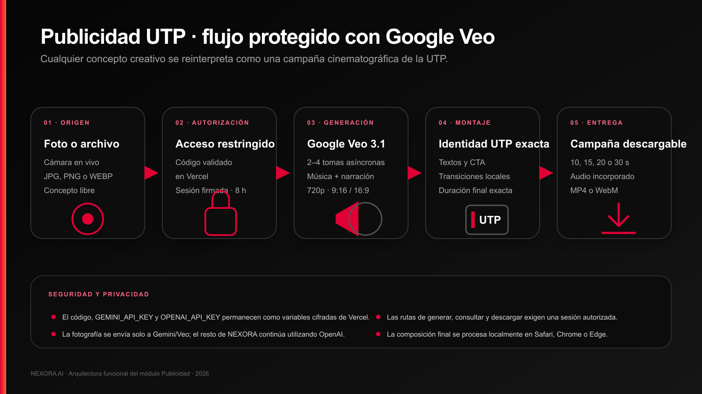
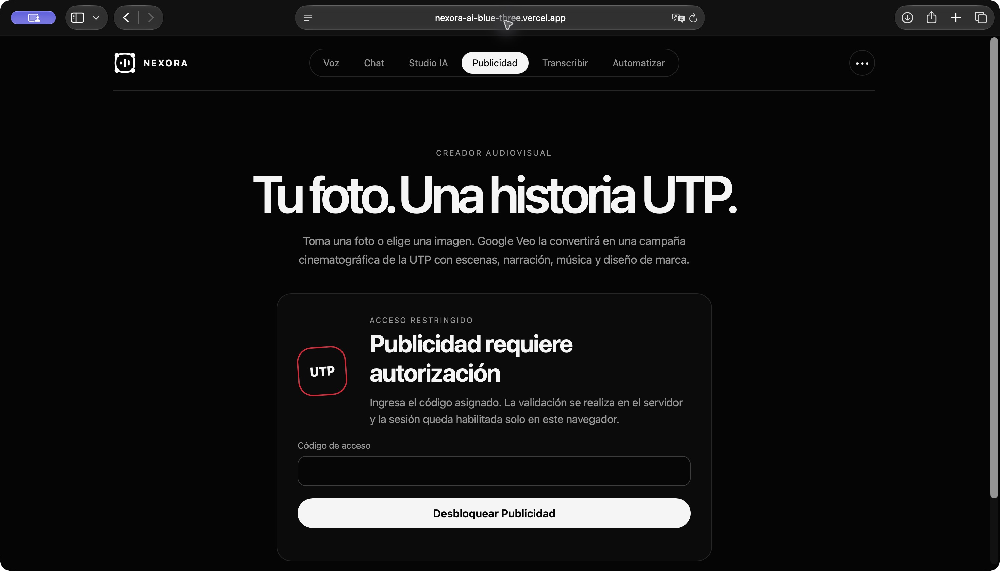

# Documentación general de NEXORA AI

## Resumen

NEXORA AI es una plataforma académica que reúne conversación, procesamiento de texto, visión, generación de imágenes, voz, transcripción, moderación y creación de publicidad audiovisual. La versión web se publica en Vercel y la misma aplicación puede ejecutarse en un contenedor Docker. Las claves de los servicios externos permanecen en el servidor.

El apartado Publicidad permite tomar o subir una fotografía, definir un concepto y obtener una pieza promocional de la Universidad Tecnológica del Perú. Google Veo genera las tomas y el audio; el navegador realiza el montaje final, incorpora la identidad UTP y guarda la fotografía, la toma original y el video terminado en Supabase.

## Aplicación publicada

- Dirección: [https://nexora-ai-blue-three.vercel.app/](https://nexora-ai-blue-three.vercel.app/)
- Publicidad: [https://nexora-ai-blue-three.vercel.app/publicidad](https://nexora-ai-blue-three.vercel.app/publicidad)

## Objetivo

Reunir en una sola interfaz servicios de texto, voz, imagen y video, con una separación clara entre el navegador, las funciones del servidor y los proveedores externos. El proyecto prioriza el uso desde computadora o teléfono, la protección de claves y rutas sensibles, la trazabilidad de fotografías y videos de Publicidad y la ejecución reproducible mediante Docker.

## Módulos disponibles

| Módulo | Función | Servicio principal |
|---|---|---|
| Chat | Conversación contextual | OpenAI Responses API |
| Studio | Resumen, corrección, traducción, guías y revisión de código | OpenAI Responses API |
| Visión | Análisis de una imagen con instrucciones | OpenAI |
| Imágenes | Creación de piezas visuales | OpenAI Image API |
| Voz | Conversación de voz con baja latencia | OpenAI Realtime API y WebRTC |
| Speech | Conversión de texto a voz | OpenAI Speech API |
| Transcripción | Conversión y resumen de audio | OpenAI Transcriptions y Responses API |
| Moderación | Revisión de contenido sensible | OpenAI Moderations API |
| Publicidad | Video promocional UTP desde una fotografía | Google Veo 3.1 Fast y Supabase |

Google Gemini se utiliza solamente en Publicidad. Los demás módulos conservan su integración con OpenAI.

## Arquitectura

```text
Navegador
  ├── Interfaz web adaptable
  ├── Cámara, micrófono y archivos locales
  ├── Canvas, Web Audio y MediaRecorder
  └── HTTPS
       └── Vercel Functions o servidor Docker
            ├── OpenAI
            │    ├── Texto, visión e imágenes
            │    ├── Voz, transcripción y moderación
            │    └── Sesiones Realtime
            ├── Google Gemini
            │    └── Veo 3.1 Fast para Publicidad
            └── Supabase
                 ├── PostgreSQL para metadatos
                 └── Storage privado para fotos y videos
```



**Figura 1.** Recorrido de una fotografía desde la captura hasta la galería privada.



**Figura 2.** Ruta Publicidad publicada en Vercel y revisada en Safari el 16 de octubre de 2026.

## Cumplimiento del flujo solicitado

### Captura

Publicidad obtiene imágenes de dos formas:

- cámara en vivo mediante `navigator.mediaDevices.getUserMedia`;
- archivo JPG, PNG o WEBP seleccionado en el dispositivo.

El navegador muestra una vista previa, reduce el lado mayor a 1280 píxeles y genera una copia JPEG optimizada. La imagen original puede pesar hasta 10 MB y la copia enviada al servicio no debe superar 3 MB.

### Transmisión

Las peticiones viajan por HTTPS. El navegador solicita una URL firmada y carga la fotografía directamente en Supabase Storage. El concepto, la duración, el formato y el estilo llegan a una función protegida del servidor. Las claves de Gemini y Supabase no se incluyen en el JavaScript público.

### Recepción y almacenamiento

Las funciones Node.js reciben y validan cada solicitud. Supabase PostgreSQL guarda identificadores, fechas, origen, prompt, duración, formato, estado y errores. Supabase Storage conserva tres evidencias:

1. fotografía tomada o subida;
2. toma original entregada por Veo;
3. video final con montaje e identidad UTP.

La plataforma también dispone de `Dockerfile` y `docker-compose.yml`. Esto permite construir y ejecutar el frontend y la API en un contenedor sin cambiar el código de la aplicación.

### Visualización

La galería de Publicidad consulta los cien registros más recientes y muestra métricas, miniatura, fecha, origen, estado, prompt, duración y formato. Los archivos se entregan mediante enlaces firmados de una hora; el bucket no es público.

Con estas cuatro etapas, el proyecto cubre captura, transmisión, recepción, almacenamiento en contenedores y visualización.

## Publicidad UTP

### Acceso

La ruta `/publicidad` muestra un formulario de autorización antes de habilitar cualquier función. El servidor compara el código con `PUBLICIDAD_ACCESS_CODE`, crea una sesión HMAC y fija una vigencia de ocho horas. El valor real no se incluye en el repositorio ni en esta documentación.

### Configuración de la campaña

| Campo | Valores |
|---|---|
| Imagen | Cámara, JPG, PNG o WEBP |
| Concepto | Texto libre de hasta 600 caracteres |
| Duración | 10, 15, 20 o 30 segundos |
| Formato | Vertical 9:16 u horizontal 16:9 |
| Estilo | Inspirador, tecnológico, energético o institucional |

El concepto del usuario se mantiene como dirección creativa. El servidor añade el contexto universitario, la relación con UTP, la narración en español, la continuidad visual y el cierre de campaña.

### Uso de la fotografía

La imagen se envía a Veo como referencia inicial con `bytesBase64Encoded` y `mimeType`. Las instrucciones solicitan conservar personas, vestimenta, objetos y entorno. Si la foto no contiene personas, el sistema dirige la escena alrededor del objeto o lugar fotografiado.

La generación de video es probabilística: la fotografía actúa como referencia obligatoria, pero el modelo puede introducir variaciones. Por esta razón, cada resultado debe revisarse antes de una publicación institucional.

### Generación

El servidor utiliza `veo-3.1-fast-generate-preview` con resolución 720p. La configuración envía relación de aspecto, duración numérica y política de generación de personas. Cada operación devuelve una toma y se consulta de forma asíncrona hasta que termina.

El costo de referencia mostrado por la interfaz es de US$0.10 por segundo generado:

| Duración final | Generación solicitada | Estimación |
|---:|---:|---:|
| 10 s | 8 s | US$0.80 |
| 15 s | 16 s | US$1.60 |
| 20 s | 20 s | US$2.00 |
| 30 s | 30 s | US$3.00 |

La tarifa real depende del precio vigente de Google, la región y el nivel de facturación.

### Montaje y entrega

El navegador reproduce las tomas, dibuja el logotipo UTP, añade textos breves y reserva la llamada a la acción para el cierre. Canvas produce la imagen, Web Audio conserva el sonido generado y MediaRecorder crea el archivo final.

En Safari, el botón **Finalizar video** inicia el montaje con una interacción directa del usuario. El compositor utiliza un reloj independiente de la reproducción para evitar que una pausa interna del navegador congele el proceso. Si la pestaña se cierra después de descargar una toma, la opción **Recuperar una toma de Veo ya generada** permite terminar el montaje sin solicitar otro video.

La toma original se archiva antes del montaje. El video final se guarda en la misma ficha cuando la exportación concluye.

## Tecnologías

| Capa | Tecnología | Uso |
|---|---|---|
| Interfaz | HTML5 y CSS | Navegación, formularios y diseño adaptable |
| Cliente | JavaScript | Cámara, validación, peticiones y montaje |
| Procesamiento | Canvas API | Escalado, composición, textos y logotipo |
| Audio | Web Audio API | Mezcla de sonido |
| Exportación | MediaRecorder | Archivo MP4 o WebM |
| Backend | Node.js y Vercel Functions | Validación y acceso a proveedores |
| Texto, visión y voz | OpenAI | Servicios generales de la plataforma |
| Video | Google Veo 3.1 Fast | Tomas publicitarias con audio |
| Base de datos | Supabase PostgreSQL | Historial y estados |
| Archivos | Supabase Storage | Fotografías y videos privados |
| Seguridad | SHA 256 y HMAC | Verificación de acceso y tokens temporales |
| Contenedor | Docker y Docker Compose | Ejecución local reproducible |
| Hosting | Vercel | Aplicación pública y funciones serverless |

## Seguridad

- Las claves se definen como variables de entorno.
- Publicidad exige una sesión firmada para crear, consultar y descargar.
- El código de acceso se valida en el servidor con comparación en tiempo constante.
- `SUPABASE_SECRET_KEY` sólo se utiliza en funciones del servidor.
- La tabla `publicidad_items` tiene RLS habilitado.
- El bucket `publicidad-utp` es privado.
- Las cargas y descargas usan enlaces firmados temporales.
- Se validan tipo MIME, tamaño, duración, formato, estilo y longitud del concepto.
- No se deben utilizar fotografías sin autorización.

## Variables de entorno

```dotenv
OPENAI_API_KEY=valor-del-entorno
OPENAI_MODEL=gpt-5-mini
GEMINI_API_KEY=valor-del-entorno
PUBLICIDAD_ACCESS_CODE=valor-del-entorno
SUPABASE_URL=https://proyecto.supabase.co
SUPABASE_SECRET_KEY=valor-del-entorno
```

Los valores reales deben configurarse en Vercel o en el entorno local. No deben aparecer en Git, capturas o presentaciones.

## Ejecución local

### Streamlit

```bash
python -m venv .venv
source .venv/bin/activate
python -m pip install -r requirements.txt
streamlit run app.py
```

### Docker

```bash
docker compose up -d --build nexora
docker compose ps nexora
curl http://localhost:3000/health
```

La interfaz queda disponible en `http://localhost:3000/` y Publicidad en `http://localhost:3000/publicidad`.

## Cómo demostrar Docker

La URL pública de Vercel utiliza funciones serverless; no ejecuta el `Dockerfile`. La demostración del contenedor se realiza en la máquina local con cuatro evidencias:

1. `docker compose up -d --build nexora` construye la imagen desde el `Dockerfile`.
2. `docker compose ps nexora` muestra el servicio en estado `Up` y luego `healthy`.
3. `curl http://localhost:3000/health` confirma que el proceso Node.js responde dentro del contenedor.
4. `http://localhost:3000/publicidad` muestra la misma interfaz servida desde el puerto publicado por Docker.

Como evidencia adicional:

```bash
docker compose logs --tail=20 nexora
docker inspect nexoraai-nexora-1 --format '{{.Config.Image}} · {{.State.Health.Status}}'
```

El nombre del contenedor puede variar. Debe utilizarse el valor que aparece en `docker compose ps`. Estos comandos no generan videos ni consumen saldo de Gemini.

## Despliegue en Vercel

1. Importar el repositorio desde GitHub.
2. Seleccionar el directorio raíz y mantener el framework sin preajuste.
3. Registrar las variables de entorno de OpenAI, Gemini, Publicidad y Supabase.
4. Desplegar.
5. Revisar `/`, `/publicidad` y los permisos de cámara y micrófono.

## Verificación técnica

```bash
python -m pytest -q
python -m py_compile app.py
npm run check
```

Las pruebas automatizadas validan sintaxis, rutas, sesiones, galería y servicios locales. No ejecutan Google Veo ni consumen saldo. Una generación real sólo debe realizarse cuando exista autorización y presupuesto.

## Guion para la presentación

1. Abrir la página principal y describir los módulos.
2. Entrar a Publicidad y mostrar el control de acceso sin revelar el código.
3. Explicar la captura mediante cámara o archivo.
4. Presentar el flujo HTTPS hacia Vercel, Gemini y Supabase.
5. Mostrar una fotografía y un video ya guardados en la galería.
6. Explicar que PostgreSQL conserva metadatos y Storage conserva archivos.
7. Ejecutar `docker compose ps nexora` y `/health` para demostrar el contenedor.
8. Cerrar con las medidas de seguridad y el control de costos.

Para la exposición conviene utilizar un video previamente generado. Así se demuestra el resultado sin depender del tiempo de espera de Veo ni consumir saldo durante la presentación.

## Limitaciones

- Veo puede tardar varios minutos.
- Cada nueva generación consume saldo.
- La fidelidad exacta respecto de una persona o un objeto no está garantizada.
- Safari requiere una interacción del usuario para iniciar el montaje con audio.
- El formato final depende de los códecs disponibles en el navegador.
- Los enlaces de la galería vencen después de una hora, aunque los archivos permanecen almacenados.
- La versión pública en Vercel demuestra la arquitectura serverless; Docker se demuestra por separado en local.

## Documentos relacionados

- [Guía del módulo Publicidad](PUBLICIDAD_UTP.md)
- [Documento general en Word](Documentacion_NEXORA_AI.docx)
- [Documento de Publicidad en Word](Documentacion_Publicidad_UTP.docx)

## Fuentes oficiales

- [OpenAI API](https://developers.openai.com/api/docs/)
- [OpenAI Realtime con WebRTC](https://developers.openai.com/api/docs/guides/voice-webrtc)
- [Google Veo](https://ai.google.dev/gemini-api/docs/veo)
- [Precios de Gemini API](https://ai.google.dev/gemini-api/docs/pricing)
- [Supabase Storage](https://supabase.com/docs/guides/storage)
- [Supabase Row Level Security](https://supabase.com/docs/guides/database/postgres/row-level-security)
- [Vercel Functions](https://vercel.com/docs/functions)
- [Docker Compose](https://docs.docker.com/compose/)
- [MediaDevices](https://developer.mozilla.org/docs/Web/API/MediaDevices)
- [Canvas API](https://developer.mozilla.org/docs/Web/API/Canvas_API)
- [Web Audio API](https://developer.mozilla.org/docs/Web/API/Web_Audio_API)
- [MediaRecorder](https://developer.mozilla.org/docs/Web/API/MediaRecorder)
- [Universidad Tecnológica del Perú](https://www.utp.edu.pe/)
