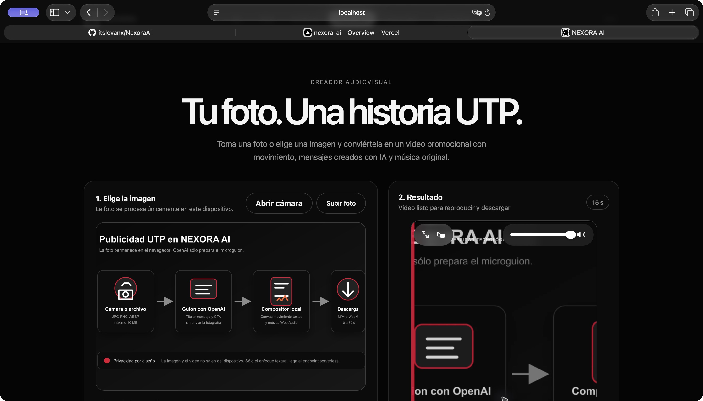
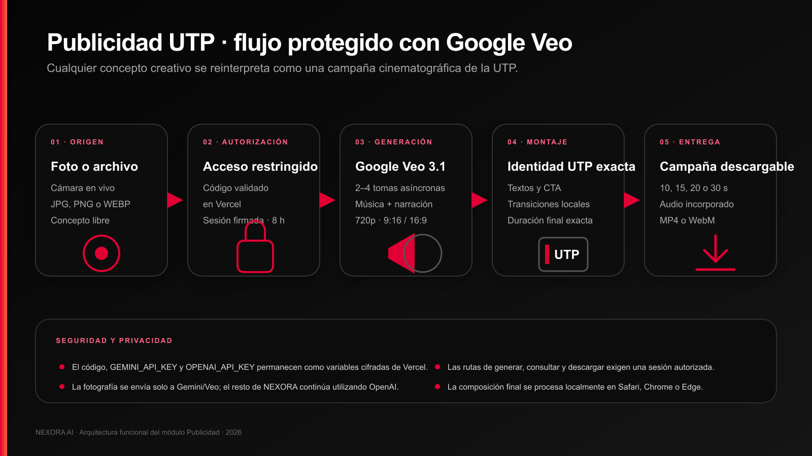

# Documentación del módulo Publicidad UTP

## Propósito de esta guía

Esta guía explica el funcionamiento técnico y funcional del apartado **Publicidad** de NEXORA AI. Está preparada para una presentación: muestra el recorrido del usuario, la arquitectura, las tecnologías, la protección de acceso, el tratamiento de la imagen, la generación audiovisual, el montaje local y los puntos que deben comprobarse antes de una demostración.

El resultado esperado es un video promocional de la Universidad Tecnológica del Perú de **10, 15, 20 o 30 segundos**, creado desde una fotografía y un concepto libre. Publicidad es el único apartado de NEXORA AI que usa Google Gemini y Google Veo. El resto de la plataforma continúa utilizando OpenAI.

## Qué resuelve el módulo

Una persona autorizada puede:

1. Entrar por el botón de la interfaz o directamente mediante `/publicidad`.
2. Desbloquear el módulo con un código validado en Vercel.
3. Tomar una fotografía en vivo o elegir una imagen guardada.
4. Escribir cualquier concepto creativo.
5. Elegir duración, orientación y tono.
6. Conocer el costo estimado antes de consumir saldo.
7. Generar varias tomas con movimiento, narración y música.
8. Recibir un único video con duración exacta, identidad UTP y llamada a la acción.
9. Reproducir y descargar el resultado desde el navegador.

Aunque el usuario pida una escena de ficción, comedia, tecnología, telenovela u otro género, el sistema conserva esa idea como dirección creativa y la convierte en una campaña UTP.

## Vista del producto



**Figura 1.** Captura histórica tomada en Safari durante la etapa del compositor local. Sirve para mostrar la estructura visual del módulo, la selección de imagen y el panel de resultado. Los textos internos que mencionan un flujo anterior no describen la integración vigente con Google Veo.

La interfaz actual mantiene la misma lógica de trabajo y añade:

- pantalla de acceso obligatorio;
- selector de 10, 15, 20 o 30 segundos;
- formatos 9:16 y 16:9;
- estilos inspirador, tecnológico, energético e institucional;
- costo estimado visible;
- confirmación antes de generar;
- progreso de las operaciones asíncronas;
- descarga final en MP4 o WebM según el navegador.

## Flujo completo



**Figura 2.** Flujo vigente desde la fotografía hasta la campaña descargable.

### Etapa 1 Acceso protegido

La ruta `/publicidad` siempre muestra el bloqueo cuando no existe una sesión válida. Esto también se aplica al acceso por enlace directo, recarga o botón interno.

1. El navegador envía el código a `/api/publicidad-acceso`.
2. La función serverless compara el valor con `PUBLICIDAD_ACCESS_CODE`.
3. La comparación usa SHA 256 y `timingSafeEqual` para reducir filtraciones por tiempo de respuesta.
4. Si el código es correcto, el servidor entrega un token HMAC.
5. La sesión dura ocho horas y se conserva en `sessionStorage`.
6. Generar, consultar operaciones y descargar tomas exige la misma sesión.

El código de acceso y el secreto de firma permanecen en Vercel. No se escriben en el código del cliente.

### Etapa 2 Captura o carga de la fotografía

El usuario puede elegir:

- **Abrir cámara:** utiliza `navigator.mediaDevices.getUserMedia`, solicita la cámara posterior cuando está disponible y captura un fotograma JPEG.
- **Subir foto:** acepta JPG, PNG o WEBP desde el dispositivo.

La interfaz admite una imagen original de hasta 10 MB. Antes de enviarla, JavaScript:

1. la decodifica en el navegador;
2. limita el lado mayor a 1280 píxeles;
3. la convierte a JPEG con calidad aproximada de 84 por ciento;
4. verifica que la copia optimizada sea menor de 3 MB;
5. conserva una vista previa para el usuario.

### Etapa 3 Configuración creativa

| Opción | Valores disponibles | Función |
|---|---|---|
| Concepto | Texto libre de hasta 600 caracteres | Define escena, género, situación o intención |
| Duración | 10, 15, 20 o 30 segundos | Determina cuántas tomas solicita el servidor |
| Formato | Vertical 9:16 u horizontal 16:9 | Adapta generación y lienzo final |
| Estilo | Inspirador, tecnológico, energético o institucional | Orienta cámara, ritmo, luz y música |

El prompt interno no reemplaza la idea del usuario. La amplía con reglas de campaña: vínculo explícito con UTP, tono universitario, narración en español, cierre institucional, llamada a la acción y coherencia entre tomas.

### Etapa 4 Generación con Google Veo

El endpoint `/api/publicidad` utiliza el modelo `veo-3.1-fast-generate-preview`. Cada solicitud incluye:

- fotografía optimizada;
- relación de aspecto elegida;
- resolución 720p;
- descripción cinematográfica de la toma;
- indicaciones de música, ambiente y narración;
- continuidad con las demás tomas;
- una única salida de video.

La fotografía se coloca en `instances[0].image` con los campos `bytesBase64Encoded` y `mimeType`. Esta forma coincide con el esquema aceptado por el modelo configurado y evita que la imagen se interprete como un bloque `inlineData` no compatible. La configuración solo envía `aspectRatio`, `durationSeconds`, `resolution` y `personGeneration`; `durationSeconds` se envía como número entero. Se omite `numberOfVideos` porque Veo ya entrega un único video por operación y ese campo es rechazado por este modelo.

La generación es asíncrona. El navegador recibe identificadores de operación y consulta su estado cada diez segundos, con un límite aproximado de siete minutos.

### Etapa 5 Montaje en el navegador

Cuando las tomas están listas, el navegador:

1. las descarga mediante enlaces temporales firmados;
2. crea un lienzo de 720 por 1280 o 1280 por 720;
3. reproduce y recorta cada toma en secuencia;
4. mezcla el audio con Web Audio;
5. superpone textos UTP exactos y elementos de marca;
6. captura el lienzo a 30 fotogramas por segundo;
7. codifica el resultado con `MediaRecorder`;
8. detiene la grabación exactamente en la duración seleccionada.

Esta separación evita depender de letras o logotipos dibujados por el modelo generativo. Veo produce la escena y el audio; Canvas controla la identidad textual final.

### Etapa 6 Entrega

El archivo final se crea en memoria y no requiere almacenamiento permanente en el servidor. Safari prioriza MP4 con H 264 y AAC cuando el navegador lo soporta. Otros navegadores pueden producir WebM con VP9, VP8 u Opus.

El nombre de descarga sigue el patrón:

```text
publicidad-utp-10s.mp4
publicidad-utp-15s.mp4
publicidad-utp-20s.webm
publicidad-utp-30s.webm
```

## Duraciones y costos estimados

El cálculo visible usa una referencia de **US$0.10 por segundo generado**. La duración solicitada a Veo puede superar ligeramente la duración final porque las tomas disponibles son de 4, 6 u 8 segundos.

| Video final | Tomas solicitadas | Segundos generados | Estimación mostrada |
|---:|---|---:|---:|
| 10 s | 6 s y 4 s | 10 s | US$1.00 |
| 15 s | 8 s y 8 s | 16 s | US$1.60 |
| 20 s | 8 s, 8 s y 4 s | 20 s | US$2.00 |
| 30 s | 8 s, 8 s, 8 s y 6 s | 30 s | US$3.00 |

Los importes son aproximados. La tarifa real depende del precio vigente, la región, el modelo habilitado y la facturación de Google.

## Tecnologías utilizadas

| Capa | Tecnología | Responsabilidad |
|---|---|---|
| Interfaz | HTML5 y CSS | Estructura, diseño adaptable, formularios y estados |
| Control del cliente | JavaScript | Validación, peticiones, progreso y coordinación del montaje |
| Cámara | MediaDevices y getUserMedia | Vista en vivo y captura de fotografía |
| Procesamiento | Canvas API | Compresión, encuadre, transiciones, textos y marca |
| Audio | Web Audio API | Mezcla del sonido generado en las tomas |
| Codificación | MediaRecorder y captureStream | Creación del archivo final en MP4 o WebM |
| Sesión local | sessionStorage | Conservación temporal del token de acceso |
| Backend | Vercel Functions con Node.js | Validación, prompts, operaciones y respuestas protegidas |
| Seguridad | Node.js Crypto | SHA 256, HMAC y comparación en tiempo constante |
| Video generativo | Gemini API y Google Veo 3.1 Fast | Conversión de imagen y prompt en tomas con audio |
| Transporte | HTTPS, Fetch y JSON | Comunicación entre navegador, Vercel y Google |
| Despliegue | Vercel | Hosting, rutas, HTTPS y variables de entorno |

## Componentes del código

| Archivo | Función |
|---|---|
| `public/index.html` | Pantalla de acceso, entrada de imagen, opciones, costo, progreso y resultado |
| `public/styles.css` | Diseño visual y adaptación a escritorio y móvil |
| `public/app.js` | Cámara, compresión, llamadas, sondeo, descarga, Canvas, audio y exportación |
| `api/publicidad-acceso.js` | Validación del código y creación de sesión |
| `api/publicidad.js` | Inicio y consulta de operaciones de Veo |
| `api/publicidad-video.js` | Descarga protegida de cada toma |
| `api/_publicidad-auth.js` | Firma HMAC, vencimiento y comparación segura |
| `api/_gemini-video.js` | Cliente de Gemini, modelo, tokens temporales y validación de host |
| `vercel.json` | Ruta pública `/publicidad` y configuración de funciones |

## Endpoints del módulo

| Método y ruta | Entrada principal | Salida |
|---|---|---|
| `POST /api/publicidad-acceso` | Código de acceso | Token y fecha de expiración |
| `POST /api/publicidad` | Foto, concepto, duración, formato y estilo | Operaciones asíncronas |
| `GET /api/publicidad?operation=...` | Identificador de operación | Estado o enlace temporal protegido |
| `GET /api/publicidad-video` | URI, token y sesión | Flujo binario de la toma |

## Cómo se garantiza la identidad UTP

La identidad de campaña se protege en dos capas.

**Capa generativa.** El servidor amplía cada concepto con reglas que obligan a presentar una experiencia vinculada con UTP, mantener narración en español, usar una estética universitaria y cerrar con una invitación clara.

**Capa de montaje.** El navegador añade los textos definitivos mediante Canvas. El prompt pide a Veo que no dibuje subtítulos, marcas de agua ni logotipos, porque esos elementos se incorporan después con tipografía controlada.

Por ejemplo, si el concepto es “crea una escena de frutinovelas”, el sistema puede conservar personajes, humor y dramatización, pero debe convertir la historia en un mensaje sobre aprendizaje, creatividad, futuro profesional o vida universitaria en UTP.

## Seguridad y privacidad

- `GEMINI_API_KEY` y `PUBLICIDAD_ACCESS_CODE` permanecen como secretos de Vercel.
- La clave de Gemini nunca se devuelve al navegador.
- Todos los endpoints audiovisuales exigen una sesión autorizada.
- Las sesiones HMAC vencen después de ocho horas.
- Los tokens de descarga vencen después de una hora.
- El servidor valida que la descarga provenga del host oficial de Google.
- Se validan tipo MIME, tamaño, duración, estilo, formato y longitud del concepto.
- La fotografía enviada a Gemini no debe contener datos sensibles ni personas sin autorización.
- El resultado debe revisarse antes de una publicación institucional.

## Variables de entorno

| Variable | Alcance | Contenido |
|---|---|---|
| `GEMINI_API_KEY` | Producción, vista previa o desarrollo | Clave de Google AI Studio con acceso a Veo |
| `PUBLICIDAD_ACCESS_CODE` | Entornos autorizados | Código privado para desbloquear el módulo |

Los valores reales no deben aparecer en Git, capturas, presentaciones o documentación compartida.

## Manejo de errores

La interfaz presenta mensajes específicos para:

- código incorrecto o sesión vencida;
- cámara no disponible o permiso rechazado;
- tipo de imagen no admitido;
- archivo original mayor de 10 MB;
- imagen optimizada mayor de 3 MB;
- concepto vacío o demasiado largo;
- saldo, cuota o modelo no habilitado;
- operación de Veo fallida;
- tiempo máximo de espera;
- descarga de toma rechazada;
- navegador sin soporte de codificación compatible.

## Guion sugerido para la presentación

1. **Problema.** Crear publicidad audiovisual requiere grabación, edición, música y conocimiento técnico.
2. **Propuesta.** NEXORA convierte una sola fotografía y un concepto libre en una campaña UTP.
3. **Acceso.** Mostrar que la ruta está protegida y que el código se valida en Vercel.
4. **Entrada.** Explicar cámara, carga de archivo y optimización local.
5. **Personalización.** Presentar duraciones, formatos y estilos.
6. **Arquitectura.** Usar la Figura 2 para explicar Veo, operaciones asíncronas y montaje local.
7. **Identidad.** Aclarar que el servidor fuerza el contexto UTP y Canvas añade textos exactos.
8. **Costos.** Mostrar la estimación antes de consumir saldo.
9. **Seguridad.** Destacar que las claves no llegan al cliente y que las descargas son temporales.
10. **Resultado.** Reproducir un video previamente generado y explicar que esta presentación no necesita hacer una nueva llamada a la API.

## Lista de verificación para una demostración

- Confirmar que el despliegue de Vercel está disponible.
- Verificar que las variables de entorno existen sin mostrar sus valores.
- Abrir `/publicidad` en Safari.
- Probar el acceso antes de la exposición.
- Revisar permisos de cámara y reproducción de audio.
- Llevar un video ya generado como respaldo.
- Confirmar saldo y límites de Google sólo si se hará una generación en vivo.
- No mostrar el código de acceso ni las claves en pantalla.
- Mantener la pestaña abierta durante el montaje.

## Alcance de esta actualización

Esta actualización crea documentación y no ejecuta Google Veo, no genera videos y no consume saldo. La validación funcional completa queda a cargo del propietario del proyecto.

## Fuentes oficiales

- [Generación de video con Google Veo](https://ai.google.dev/gemini-api/docs/veo)
- [Precios de Gemini API](https://ai.google.dev/gemini-api/docs/pricing)
- [Vercel Functions](https://vercel.com/docs/functions)
- [MediaDevices](https://developer.mozilla.org/docs/Web/API/MediaDevices)
- [Canvas API](https://developer.mozilla.org/docs/Web/API/Canvas_API)
- [Web Audio API](https://developer.mozilla.org/docs/Web/API/Web_Audio_API)
- [MediaRecorder](https://developer.mozilla.org/docs/Web/API/MediaRecorder)
- [Universidad Tecnológica del Perú](https://www.utp.edu.pe/)
